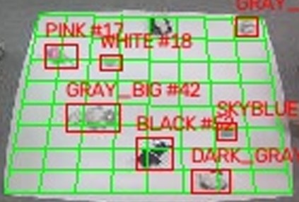

# AGV 작업판 물체 격자 위치 인식

AGV 작업판을 위에서 찍은 영상 한 장에서 판 위 물체(인형 7종, AGV)를 검출하고, 각 물체가 8×8 격자의 어느 칸에
있는지 알려주는 서비스다. Jetson Nano에서 onnxruntime으로 돈다. 데이터셋, 학습 결과, 최적화, 배포 설정은
[`log/service-log.md`](log/service-log.md)(이하 로그)에 있다.



## 동작

```
영상 ─┬─> [판 검출] 흑백 변환 → 테두리 마스킹 → 임계값 → 가장 큰 윤곽 → 꼭짓점 4개 ─┐
      │                                                                          ├─> [칸 배정] → (클래스, 신뢰도, 칸)
      └─> [물체 검출] 레터박스 640² → YOLOv5s (ONNX) → 클래스별 NMS ─────────────────┘
```

1. **판 검출.** 흑백 영상의 테두리를 가리고 임계값보다 밝은 픽셀만 남긴 뒤, 가장 큰 윤곽을 사각형으로 근사해
   꼭짓점 4개를 좌상·우상·우하·좌하 순으로 정렬한다(`src/preprocessing.py`, `src/plate_detection.py`).
2. **물체 검출.** YOLOv5s ONNX 모델로 8클래스(BLACK, DARK_GRAY, GRAY_BIG, GRAY_SMALL, PINK, SKYBLUE, WHITE,
   AGV)를 검출하고, 같은 클래스끼리 겹친 박스를 NMS로 정리한다(`src/yolo_onnx.py`).
3. **칸 배정.** 판 꼭짓점으로 영상 → 격자 좌표 원근 변환을 만들고, 박스 중심을 변환해 칸(행, 열, 번호)을 정한다.
   번호는 좌상단이 0인 행 우선 순서다. 중심이 판 밖이면 칸 없이 보고하고, 판을 찾지 못하면 모든 검출을 칸 없이
   보고한다(`src/grid_mapping.py`).

## 사용 방법

**1. 설치.**

```bash
pip install -r requirements.txt
```

**2. 모델.** [Releases](https://github.com/donghyeoni/agv-grid-localization/releases/tag/v1.0.0)에서 `best.onnx`를 받는다.

**3. 영상 한 장.**

```bash
python localize.py --model best.onnx --image photo.jpg --save out.png --json out.json
```

```
class         conf  cell
GRAY_BIG      0.90  (5,2) #42
PINK          0.86  (2,1) #17
DARK_GRAY     0.86  (7,5) #61
...
```

| 옵션 | 기본값 | 내용 |
|---|---|---|
| `--threshold` | 170 | 판 분리 흑백 임계값 |
| `--border-thickness` | 30 | 가장자리 마스킹 폭(px) |
| `--grid-size` | 8 | 한 변의 칸 수 |
| `--conf` | 0.25 | 검출 신뢰도 임계값 |
| `--save`, `--json` | 없음 | 주석 영상, 검출 결과 JSON 저장 경로 |
| `--no-show` | 꺼짐 | 결과 창을 띄우지 않음 |

**4. Jetson Nano (JetPack 4.6, Python 3.6).** 레포와 `best.onnx`를 기기에 복사하고, Jetson용 onnxruntime-gpu를 설치한다.
`import cv2`가 되지 않을 때만 `opencv-python`도 설치한다.

```bash
wget https://nvidia.box.com/shared/static/jy7nqva7l88mq9i8bw3g3sklzf4kccn2.whl \
     -O onnxruntime_gpu-1.10.0-cp36-cp36m-linux_aarch64.whl
pip3 install onnxruntime_gpu-1.10.0-cp36-cp36m-linux_aarch64.whl
pip3 install numpy
```

레포 루트에서 실행한다.

```bash
python3 localize.py --model best.onnx --image photo.jpg --no-show --json out.json
python3 deploy/camera_demo.py --model best.onnx --csi        # CSI 카메라
python3 deploy/camera_demo.py --model best.onnx --camera 0   # USB 카메라
```

카메라 데모는 프레임마다 처리 시간과 `클래스@칸번호`를 출력한다.

**5. 모델 학습 (선택).** 데이터셋은 레포에 없다. [작성자](https://github.com/donghyeoni)에게 요청해 `data/` 아래에 둔다.
학습에는 CUDA GPU가 필요하고, 첫 실행 때 YOLOv5 v7.0을 `third_party/`에 받는다.

```bash
python scripts/prepare_dataset.py        # 두 Roboflow 데이터셋을 8클래스로 병합
python scripts/train.py --epochs 100 --batch 32
python scripts/export_onnx.py            # -> runs/agv-grid-8cls/weights/best.onnx (opset 12)
```
