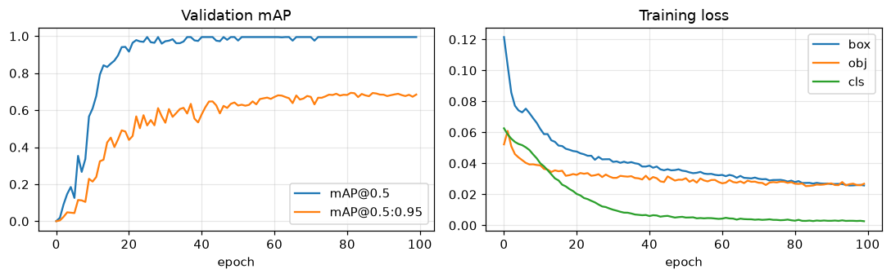
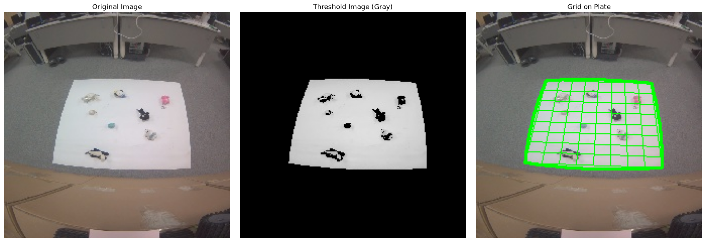

# AGV Plate Grid Detection

  

A vision pipeline for AGV (Automated Guided Vehicle) workspace localization:
given one overhead photo, it finds the white plate, overlays a
perspective-correct **8x8 grid** (classical OpenCV), detects the objects on the
plate with a custom-trained **YOLOv5** model (7 doll classes + AGV), and reports
**which grid cell** each object occupies. The trained model is exported to
**ONNX (opset 12)** and runs on a **Jetson Nano** with onnxruntime.


*Each detection is labeled with its class and grid-cell index (row-major,
0 = top-left, 63 = bottom-right): `PINK #17`, `BLACK #52`, `DARK_GRAY #61`, ...*

## Pipeline

1. **Plate grid (classical CV)** — mask image borders, threshold the grayscale
   image, take the largest bright contour as the plate, order its 4 corners,
   and draw a perspective-correct 8x8 grid
   ([`src/preprocessing.py`](src/preprocessing.py),
   [`src/plate_detection.py`](src/plate_detection.py), [`src/grid.py`](src/grid.py)).
2. **Object detection (YOLOv5)** — a YOLOv5s model trained on a merged 8-class
   dataset, run through ONNX Runtime ([`src/yolo_onnx.py`](src/yolo_onnx.py)).
3. **Grid-cell mapping** — each box center is projected through the plate's
   perspective transform into grid coordinates and assigned a cell
   ([`src/grid_mapping.py`](src/grid_mapping.py)).

## Results

Trained on 412 images (371 train / 17 val / 24 test) for 100 epochs
(YOLOv5s, 640 px, batch 32 — 2.5 min on an NVIDIA L40S).



**Test set** (24 images, 144 instances):

| Class | P | R | mAP@0.5 | mAP@0.5:0.95 |
| --- | --- | --- | --- | --- |
| **all** | **0.989** | **0.989** | **0.995** | **0.654** |
| BLACK | 0.986 | 1.000 | 0.995 | 0.649 |
| DARK_GRAY | 0.985 | 0.950 | 0.993 | 0.644 |
| GRAY_BIG | 0.978 | 1.000 | 0.995 | 0.674 |
| GRAY_SMALL | 0.986 | 1.000 | 0.995 | 0.728 |
| PINK | 0.990 | 1.000 | 0.995 | 0.700 |
| SKYBLUE | 0.997 | 1.000 | 0.995 | 0.571 |
| WHITE | 1.000 | 0.961 | 0.995 | 0.493 |
| AGV | 0.993 | 1.000 | 0.995 | 0.771 |

## Dataset

Two Roboflow exports (not committed; place them under `data/`):

- `kkk8-detection` v2 — 8 doll classes, 383 images
- `agvdetect` v1 — 1 class (`AGV`), 40 images

`scripts/prepare_dataset.py` merges them into one 8-class dataset:
`DOG` is renamed to `DARK_GRAY`, the unused `RATEL` class is dropped, and
`AGV` is appended, giving
`[BLACK, DARK_GRAY, GRAY_BIG, GRAY_SMALL, PINK, SKYBLUE, WHITE, AGV]`.

## Structure

```
├── localize.py               # full pipeline demo: grid + detection + cell mapping
├── detect.py                 # stage-1-only demo (plate grid overlay)
├── run_all.py                # regenerate results/ from the bundled sample image
├── config.py                 # border thickness, threshold, grid size defaults
├── src/
│   ├── preprocessing.py      # load, border mask, threshold
│   ├── plate_detection.py    # largest contour, corner ordering
│   ├── grid.py               # perspective-correct grid drawing
│   ├── grid_mapping.py       # box center -> grid cell (row, col, index)
│   └── yolo_onnx.py          # ONNX Runtime YOLOv5 inference (PC & Jetson)
├── scripts/
│   ├── prepare_dataset.py    # merge the two Roboflow exports (8 classes)
│   ├── train.py              # YOLOv5 v7.0 training wrapper
│   └── export_onnx.py        # best.pt -> ONNX (opset 12, simplified)
├── deploy/                   # Jetson Nano setup notes + live camera demo
├── assets/                   # figures used by this README
└── sample_images/            # bundled demo input
```

## Setup

```bash
python -m venv .venv
# Windows: .venv\Scripts\activate  |  Linux/macOS: source .venv/bin/activate
pip install -r requirements.txt
```

## Usage

Train and export (requires the datasets under `data/` and a CUDA GPU;
training deps are installed by the YOLOv5 repo cloned on first run):

```bash
python scripts/prepare_dataset.py
python scripts/train.py --epochs 100 --batch 32
python scripts/export_onnx.py            # -> runs/agv-grid-8cls/weights/best.onnx
```

Run the full pipeline on an image:

```bash
python localize.py --model best.onnx --image photo.jpg --save out.png --json out.json
```

```
class         conf  cell
GRAY_BIG      0.90  (5,2) #42
PINK          0.86  (2,1) #17
DARK_GRAY     0.86  (7,5) #61
...
```

Grid-only demo (no model needed):

```bash
python detect.py --image sample_images/image_0000.jpg
```



## Jetson Nano deployment

The exported ONNX model (opset 12) runs on Jetson Nano with onnxruntime —
no PyTorch on the device. See [`deploy/README.md`](deploy/README.md) for the
JetPack setup and the live camera demo (`deploy/camera_demo.py`).

## Notes

- **Plate detection is threshold-based.** The defaults (`--threshold 170`,
  `--border-thickness 30`) were tuned for the sample scene; different lighting
  needs retuning. If no 4-corner plate contour is found, detections are still
  reported but without cell indices.
- **AGV class has few samples** (40 boxes), so its box-precision
  (mAP@0.5:0.95) is less reliable than the doll classes despite the high
  mAP@0.5.

## Contributors

- [donghyeoni](https://github.com/donghyeoni)
- [Kyung Sejin (kkkksj)](https://github.com/kkkksj)
