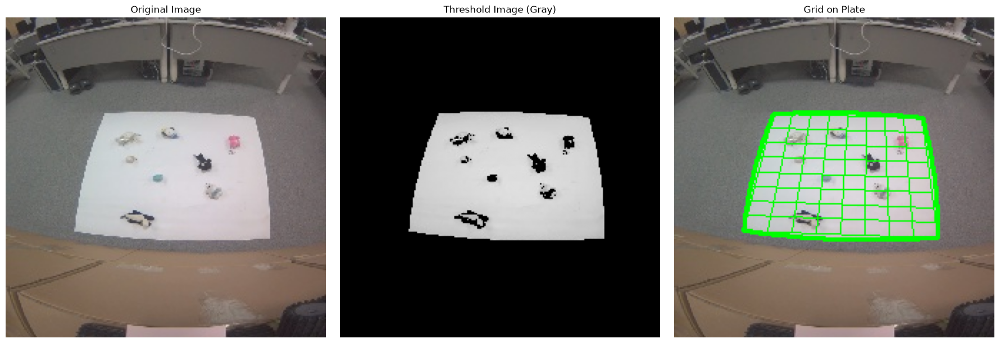

# Results

Produced by a single reproducible command on the bundled sample image
(`sample_images/image_0000.jpg`, 224x224):

```bash
python run_all.py
```

Artifacts are written to [`results/`](results/) and tracked in git.

## Plate detection

With the default parameters (`border_thickness=30`, `gray_threshold=170`,
`grid_size=8`), the pipeline isolates the plate as the largest bright contour
(area **10775 px**) and recovers its four corners:

| Corner | (x, y) |
| --- | --- |
| Top-left | (69, 67) |
| Top-right | (173, 70) |
| Bottom-right | (184, 154) |
| Bottom-left | (48, 149) |

Full machine-readable output: [`results/detection.json`](results/detection.json).



*Left to right: original image, border-masked threshold, and the
perspective-correct 8x8 grid overlaid on the detected plate.*
